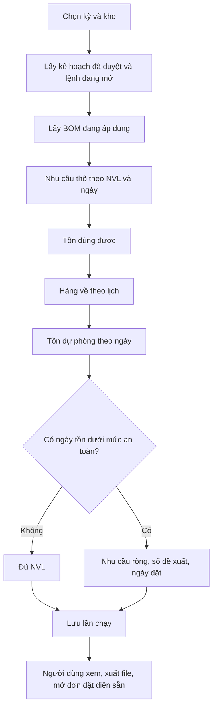

# 04 — Quy trình MRP đề xuất (Phase 4)

Đề xuất, chưa triển khai. Các quy tắc BR-MRP-xx ở file 03.

## 1. Quy trình chính

| Bước | Ai | Việc | Dữ liệu, quy tắc |
|---|---|---|---|
| 1 | Người dùng | Chọn kỳ tính: từ hôm nay tới ngày kết thúc (mặc định 30 ngày) | Tối đa 366 ngày |
| 2 | Người dùng | Chọn kho NVL, hoặc nhiều kho coi như một nhóm | Chỉ kho được phân quyền |
| 3 | Hệ thống | Lấy kế hoạch `APPROVED` có dòng bắt đầu trong kỳ, và lệnh `NOT_STARTED` / `IN_PROGRESS` | BR-MRP-02, 07 |
| 4 | Hệ thống | Lấy BOM đang áp dụng của từng thành phẩm; tách riêng thành phẩm thiếu BOM | BR-MRP-05, 06 |
| 5 | Hệ thống | Tính nhu cầu thô theo NVL và ngày | BR-MRP-01, 03, 04 |
| 6 | Hệ thống | Lấy tồn dùng được | BR-MRP-10, 17 |
| 7 | Hệ thống | (Không có giữ chỗ lưu sẵn.) Sắp nhu cầu theo thứ tự ưu tiên để phân bổ | BR-MRP-21, 22 |
| 8 | Hệ thống | Lấy hàng về theo lịch: đơn đặt có ngày giao, phiếu chuyển đang đi | BR-MRP-11..15 |
| 9 | Hệ thống | Tính tồn dự phóng theo ngày | File 03 mục 4 |
| 10 | Hệ thống | Xác định ngày thiếu của từng NVL và kế hoạch, lệnh bị ảnh hưởng | BR-MRP-18, 21 |
| 11 | Hệ thống | Tính nhu cầu ròng | BR-MRP-19, 20 |
| 12 | Hệ thống | Tính số đề xuất mua và ngày đặt; lưu lần chạy | BR-MRP-23..29 |
| 13 | Người dùng | Xem kết quả: tổng quan, theo tháng, theo ngày, NVL thiếu, đề xuất mua | |
| 14 | Người dùng | Xuất Excel, hoặc bấm "Lập đơn đặt hàng" để mở đơn đặt điền sẵn | BR-MRP-27, 28 |

## 2. Vai trò

| Vai trò | Việc |
|---|---|
| Kế toán sản xuất | Chạy MRP, xem kết quả, báo NVL thiếu |
| Manager | Chạy MRP, xem kết quả, quyết định mua hoặc chuyển kho, dời kế hoạch |
| Người mua hàng (vai trò có `feat-purchase-orders`) | Lập đơn đặt từ đề xuất, nhập ngày giao dự kiến |
| Thủ kho | Nhận hàng; hoàn thành phiếu nhập để hàng vào tồn |

MRP không thêm vai trò mới (quy tắc dự án: không tự thêm actor).

## 3. Khi kế hoạch đã duyệt thay đổi

Kết quả MRP là ảnh chụp tại lúc chạy. Kế hoạch đổi thì kết quả cũ không tự cập nhật.

| Thay đổi | Xử lý |
|---|---|
| Đổi số lượng dòng (`UpdateProductionPlanCommand`) | Lần chạy cũ bị đánh dấu **lỗi thời**: hệ thống so `trx_production_plans.updated_at` với thời điểm chạy. Người dùng chạy lại |
| Đổi ngày của dòng | Như trên; ngày cần và ngày đặt đổi theo. Nếu ngày đặt mới đã qua thì ra trạng thái Trễ |
| Thêm dòng | Như trên |
| Đóng hoặc hủy kế hoạch | Như trên; phần chưa lập lệnh biến mất khỏi nhu cầu. Lệnh còn mở vẫn tính |
| Lập lệnh từ kế hoạch | Tổng nhu cầu không đổi (chuyển từ phần kế hoạch sang phần lệnh); không cần chạy lại |
| Xuất NVL cho lệnh | Tồn và nhu cầu cùng giảm; lượng thiếu không đổi |
| Kích hoạt BOM phiên bản mới | Phần chưa lập lệnh tính theo BOM mới ở lần chạy sau; lệnh đã lập giữ nhu cầu đã chụp |
| Đơn đặt bị hủy, hoặc đổi ngày giao | Nguồn về thay đổi; cần chạy lại. Phát hiện bằng `trx_purchase_orders.updated_at` |

**Cách báo lỗi thời:** khi mở một lần chạy, hệ thống kiểm có kế hoạch, lệnh hoặc đơn đặt nào trong phạm vi được cập nhật sau thời điểm chạy không. Có thì hiện dải cảnh báo "Dữ liệu đã thay đổi sau lần tính này" và nút "Tính lại". Không tự chạy lại ngầm.

## 4. Luồng thay thế và ngoại lệ

| Tình huống | Xử lý |
|---|---|
| Không có kế hoạch hay lệnh nào trong kỳ | Kết quả rỗng, thông báo rõ; vẫn lưu lần chạy |
| Thành phẩm thiếu BOM | Liệt kê riêng; không làm hỏng phép tính |
| NVL chưa có thời gian giao | Có số thiếu, không có ngày đặt; có bộ lọc để bổ sung dữ liệu |
| Người dùng không có quyền với kho | Từ chối chạy |
| Kho đang kiểm kho | Vẫn chạy; ghi chú số tồn có thể đổi |
| Hai người chạy cùng lúc | Mỗi người một lần chạy riêng; không ghi đè nhau |
| Lỗi giữa chừng khi lưu | Hoàn tác cả lần chạy (một transaction), không để lại kết quả dở |
