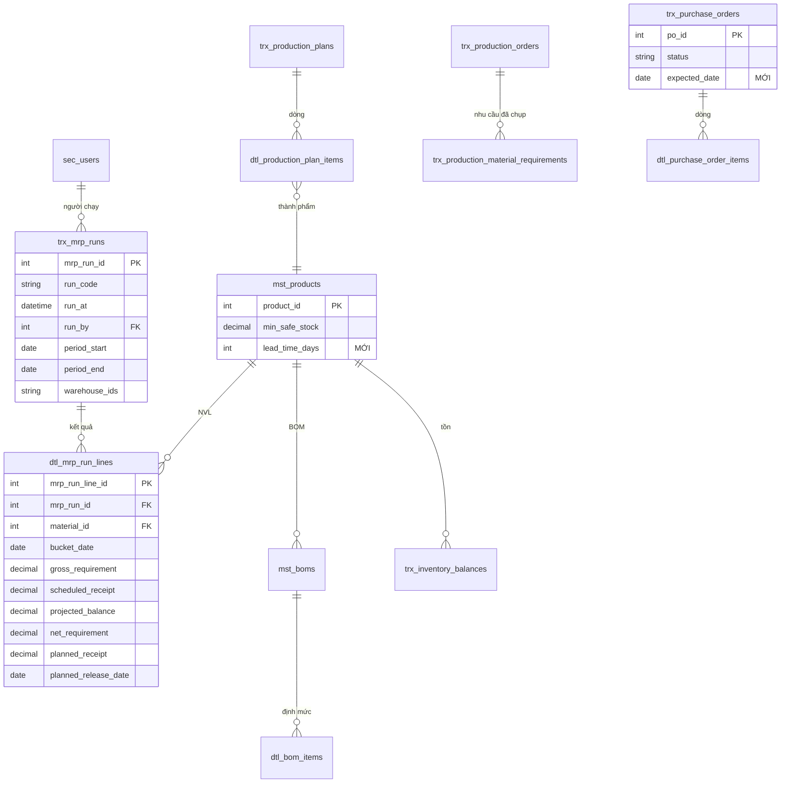

# 06 — Đề xuất database

Chỉ là đề xuất. Chưa có bảng, cột hay migration nào được tạo. Schema thật do EF migration quản lý; không sửa tay (`CLAUDE.md`).

## 1. Bảng hiện có dùng lại

| Bảng | Dùng cho | Đổi gì |
|---|---|---|
| `trx_production_plans`, `dtl_production_plan_items` | Nguồn nhu cầu; ngày cần; `updated_at` để báo lỗi thời | Không |
| `trx_production_orders`, `dtl_production_order_items`, `trx_production_material_requirements` | Nhu cầu còn phải xuất của lệnh | Không |
| `mst_boms`, `dtl_bom_items` | Định mức, hao hụt, phiên bản | Không |
| `trx_inventory_balances`, `mst_inventory_lots` | Tồn đầu kỳ, hạn dùng | Không |
| `trx_purchase_orders`, `dtl_purchase_order_items`, `trx_goods_receipts`, `dtl_goods_receipt_items` | Hàng đang đặt, đã nhận | **Thêm 1 cột** |
| `trx_stock_transfers`, `dtl_stock_transfer_items` | Hàng đang chuyển tới | Không |
| `mst_products` | Loại hàng, đơn vị, tồn an toàn | **Thêm 1 cột** |
| `mst_warehouses`, `jnc_user_warehouse_access` | Kho, quyền kho | Không |

Không tạo bảng "nhu cầu NVL của kế hoạch" hay "lịch sản xuất": nhu cầu tính từ BOM, ngày lấy từ dòng kế hoạch.

## 2. Cột thêm vào bảng hiện có (bắt buộc)

| Bảng | Cột | Kiểu | Rỗng | Ý nghĩa |
|---|---|---|---|---|
| `mst_products` | `lead_time_days` | integer | Có | Số ngày từ lúc đặt tới lúc hàng vào kho. Rỗng = chưa khai báo |
| `trx_purchase_orders` | `expected_date` | date | Có | Ngày hàng dự kiến về. Rỗng với đơn cũ. Report 3 đã yêu cầu trường này (FR-PUR-02) |

Cả hai là cột cho phép rỗng, không đổi dữ liệu cũ. Loại dữ liệu: dữ liệu gốc và dữ liệu giao dịch.

## 3. Bảng mới (chỉ khi chốt lưu lịch sử, Q8)

### `trx_mrp_runs` — một lần chạy MRP

| Cột | Kiểu | Rỗng | Ghi chú |
|---|---|---|---|
| `mrp_run_id` | serial | Không | **PK** |
| `run_code` | varchar(20) | Không | Duy nhất; sinh từ sequence qua `ITransactionCodeGenerator` |
| `run_at` | timestamp | Không | Giờ Việt Nam |
| `run_by` | integer | Không | **FK** → `sec_users` |
| `period_start`, `period_end` | date | Không | Kỳ tính |
| `warehouse_ids` | varchar(200) | Không | Danh sách kho, cách nhau dấu phẩy |
| `include_pending_plans` | boolean | Không | Có tính kế hoạch chờ duyệt không |
| `material_count`, `shortage_count`, `late_count` | integer | Không | Số tổng hợp để hiện danh sách nhanh |
| `notes` | varchar(500) | Có | Ví dụ thành phẩm thiếu BOM |

- Chỉ mục: duy nhất trên `run_code`; thường trên `run_at`.
- Loại: **lịch sử** (không sửa sau khi tạo).
- Lưu danh sách kho dạng chuỗi để tránh thêm bảng nối; nếu nhóm muốn chuẩn hóa thì thay bằng bảng `jnc_mrp_run_warehouses`.

### `dtl_mrp_run_lines` — kết quả theo NVL và ngày

| Cột | Kiểu | Rỗng | Ghi chú |
|---|---|---|---|
| `mrp_run_line_id` | serial | Không | **PK** |
| `mrp_run_id` | integer | Không | **FK** → `trx_mrp_runs`, xóa theo lần chạy |
| `material_id` | integer | Không | **FK** → `mst_products` |
| `bucket_date` | date | Không | Ngày |
| `gross_requirement` | numeric(18,2) | Không | GR |
| `scheduled_receipt` | numeric(18,2) | Không | SR |
| `projected_balance` | numeric(18,2) | Không | Tồn nếu không mua thêm; có thể âm |
| `net_requirement` | numeric(18,2) | Không | NR |
| `planned_receipt` | numeric(18,2) | Không | POR |
| `planned_release_date` | date | Có | Ngày đặt; rỗng khi NVL chưa có thời gian giao |
| `is_late` | boolean | Không | Ngày đặt đã qua lúc chạy |

- Chỉ mục: duy nhất trên (`mrp_run_id`, `material_id`, `bucket_date`); thường trên `material_id`.
- Loại: **số tính ra, lưu làm ảnh chụp**.
- Chỉ lưu ngày có biến động, kèm một dòng tồn đầu kỳ cho mỗi NVL.

### Bảng tùy chọn

| Bảng | Mục đích | Khi nào cần |
|---|---|---|
| `dtl_mrp_run_demands` (lần chạy, NVL, ngày, `production_plan_item_id` hoặc `production_order_id`, số lượng, số được cấp) | Truy vết nhu cầu đến từ kế hoạch / lệnh nào và được cấp bao nhiêu | Khi cần xem lại phân bổ của lần chạy cũ. Lần chạy mới nhất có thể tính lại nên chưa bắt buộc |
| `mst_non_working_days` (ngày, mô tả) | Ngày nghỉ lễ | Khi chốt Q9 |
| Cột cấu hình đệm an toàn, ngày nghỉ tuần | Tham số chung | Khi chốt Q9 |
| `mst_product_suppliers` | Thời gian giao theo nhà cung cấp | Khi cần chọn nhà cung cấp tự động |
| `mst_boms.effective_from` | Ngày hiệu lực BOM | Khi cần tính BOM theo ngày |
| Bảng giữ chỗ NVL | Khóa tồn cho kế hoạch | Không khuyến nghị: mọi luồng xuất kho đang chạy phải sửa theo |

## 4. Sequence

`stockflow.seq_mrp_run_code` cho mã lần chạy, theo quy ước mã chứng từ lấy từ sequence (`ITransactionCodeGenerator`, loại mới `MRP_RUN`).

## 5. Sơ đồ quan hệ

## 6. Tổng hợp thay đổi

| Mức | Thay đổi |
|---|---|
| Bắt buộc | 2 cột (`lead_time_days`, `expected_date`) |
| Bắt buộc nếu chốt lưu lịch sử | 2 bảng (`trx_mrp_runs`, `dtl_mrp_run_lines`), 1 sequence |
| Tùy chọn | Các mục ở bảng tùy chọn |

Việc đi kèm: cập nhật `database/stockflow.sql` và file PlantUML. Hai file này hiện còn thiếu cả bảng kế hoạch sản xuất.
