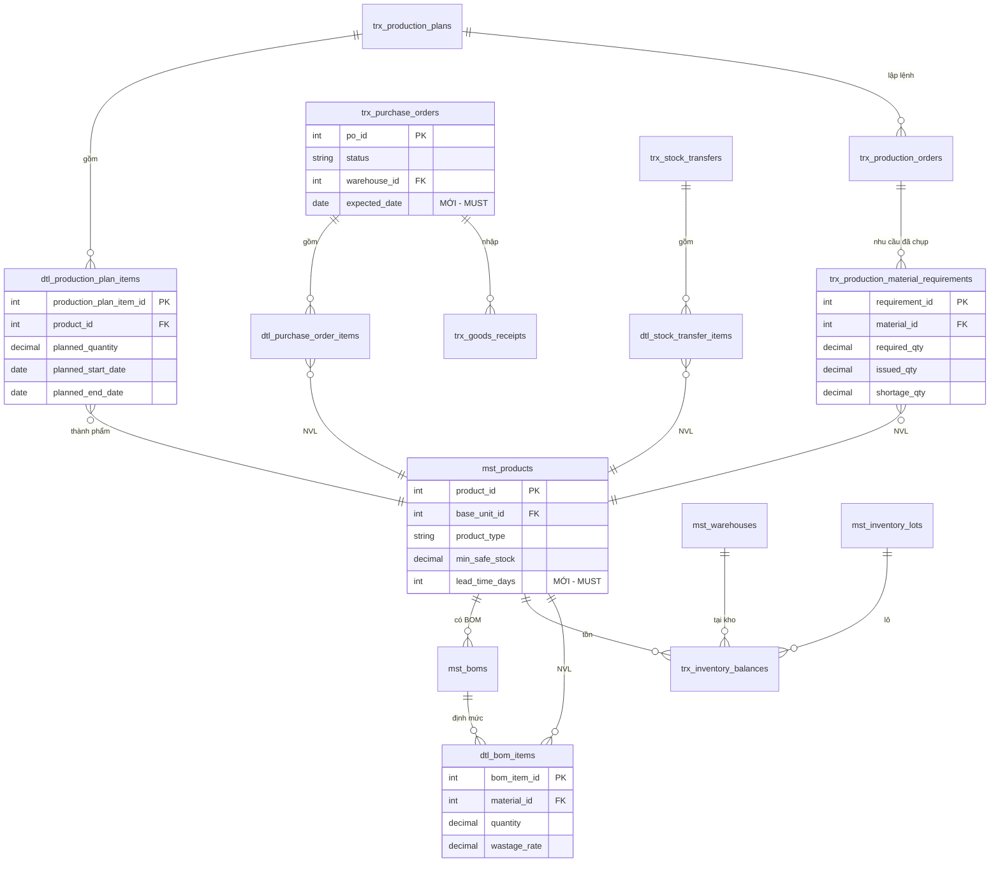

# 03 — Phân tích database (Phần 5)

Chỉ là đề xuất. Chưa có migration, entity hay thay đổi schema nào được tạo. Mọi thay đổi schema cần nhóm duyệt và đi qua EF migration (CLAUDE.md, mục Database files).

## 1. Nguyên tắc

- Kết quả MRP là **số tính ra**, không lưu, giống cách kế hoạch đang làm (quyết định Q8, G8 ở `specs/production-planning-analysis/07-erd-gap-analysis.md`). Lý do: BOM, tồn, đơn mua đổi liên tục; bản lưu sẽ lệch.
- Chỉ thêm cột cho **dữ liệu đầu vào còn thiếu**. Không tạo bảng trùng chức năng với bảng đang có.

## 2. Sáu nhóm dữ liệu

| Nhóm | Bảng hiện có dùng được | Còn thiếu | Cần bảng mới? | Phân loại |
|---|---|---|---|---|
| 1. Production Plan | `trx_production_plans`, `dtl_production_plan_items` | Không | Không | — |
| 2. Production Schedule | `dtl_production_plan_items.planned_start_date`, `planned_end_date` | Lịch theo ngày, công đoạn | **Không** với phương án A. Phương án B, C mới cần | — |
| 3. Material Requirement | Kế hoạch: tính từ `mst_boms`, `dtl_bom_items`. Lệnh: `trx_production_material_requirements` | Không | Không. Bảng ảnh chụp là NICE TO HAVE | — |
| 4. Material Allocation | Không có | Giữ chỗ | Không ở giai đoạn đầu (phân bổ mềm). Bảng giữ chỗ là NICE TO HAVE | — |
| 5. Material Supply | `trx_inventory_balances`; `trx_purchase_orders` + `dtl_purchase_order_items`; `trx_goods_receipts` (`DRAFT`); `trx_stock_transfers` (`IN_TRANSIT`) | Ngày giao dự kiến của đơn mua; lead time của NVL | Không. Thêm cột | **MUST** |
| 6. Material Readiness | Không có | Trạng thái sẵn sàng | Không. Tính từ nhóm 3–5 | — |

## 3. Thay đổi đề xuất

### 3.1 MUST — thêm cột

**`mst_products` (bảng đang có)**

| Cột mới | Kiểu | Rỗng | Ý nghĩa |
|---|---|---|---|
| `lead_time_days` | integer | Có | Số ngày từ lúc đặt hàng tới lúc hàng đến kho, gồm thời gian nhà cung cấp và vận chuyển. Rỗng = chưa khai báo, MRP không tính được ngày đặt hàng |

- Khóa chính, khóa ngoại: không đổi.
- Cột liên quan đã có: `base_unit_id`, `product_type`, `min_safe_stock`, `reorder_point`, `is_active`.

**`trx_purchase_orders` (bảng đang có)**

| Cột mới | Kiểu | Rỗng | Ý nghĩa |
|---|---|---|---|
| `expected_date` | date | Có | Ngày hàng dự kiến đến kho. Rỗng với đơn cũ |

- Đặt ở đầu đơn, không ở dòng, vì đơn mua hiện nhập một lần cho cả đơn là chính. Ngày theo dòng là NICE TO HAVE.
- Cột liên quan đã có: `status` (`DRAFT`, `ORDERED`, `PARTIAL`, `COMPLETED`, `CANCELLED`), `warehouse_id`, `order_date`.

### 3.2 SHOULD — cấu hình chung

Thời gian kiểm nhận, đệm an toàn và ngày nghỉ hằng tuần là cấu hình toàn hệ thống. Hai lựa chọn:

| Lựa chọn | Nội dung | Nhận xét |
|---|---|---|
| a | Thêm cột vào `mst_order_settings` (dòng id 1): `mrp_inspection_days`, `mrp_safety_days`, `mrp_weekly_off_days` | Ít thay đổi nhất, nhưng bảng này đang mang nghĩa thiết lập đơn hàng |
| b | Bảng mới `mst_production_settings` một dòng | Sạch hơn; thêm một bảng |

Khuyến nghị: (a) nếu nhóm muốn tối thiểu; cần nhóm quyết định (Q-M8).

### 3.3 NICE TO HAVE — bảng mới

**`mst_non_working_days`** (ngày nghỉ lễ)

| Cột | Kiểu | Ghi chú |
|---|---|---|
| `non_working_day_id` | serial | PK |
| `off_date` | date | Duy nhất |
| `description` | varchar(200) | |

Không có khóa ngoại.

**`trx_material_reservations`** (giữ chỗ cứng, chỉ khi chủ dự án yêu cầu khóa tồn)

| Cột | Kiểu | Ghi chú |
|---|---|---|
| `reservation_id` | serial | PK |
| `material_id` | int | FK → `mst_products` |
| `warehouse_id` | int | FK → `mst_warehouses` |
| `production_plan_item_id` | int, rỗng | FK → `dtl_production_plan_items` |
| `production_order_id` | int, rỗng | FK → `trx_production_orders` |
| `reserved_qty` | numeric(18,2) | |
| `needed_date` | date | |
| `status` | varchar(20) | ACTIVE / RELEASED / CONSUMED |
| `created_by`, `created_at` | | FK → `sec_users` |

Cảnh báo: bảng này chỉ có nghĩa khi **mọi** luồng xuất kho (bán hàng, chuyển kho, xuất hủy, xuất NVL) đều trừ phần đã giữ. Đó là thay đổi lớn trên các module đang chạy.

**`mst_product_suppliers`** (NVL – nhà cung cấp, lead time theo nhà cung cấp)

| Cột | Kiểu | Ghi chú |
|---|---|---|
| `product_supplier_id` | serial | PK |
| `product_id` | int | FK → `mst_products` |
| `partner_id` | int | FK → `mst_business_partners` |
| `lead_time_days` | int | |
| `is_preferred` | bool | |

Chỉ cần khi muốn đề xuất mua tự chọn nhà cung cấp.

**Ảnh chụp kết quả MRP** (`trx_mrp_runs`, `dtl_mrp_run_lines`): chỉ cần nếu nhóm muốn lưu lịch sử "tại thời điểm duyệt, thiếu gì". Không khuyến nghị ở giai đoạn đầu.

## 4. Nguồn dữ liệu cho từng đại lượng (không cần bảng mới)

| Đại lượng | Cách lấy |
|---|---|
| Tồn hiện có | `SUM(trx_inventory_balances.quantity)` theo (kho, hàng); loại lô có `mst_inventory_lots.expiry_date` < ngày cần |
| Đang đặt mua | Đơn `ORDERED`, `PARTIAL`: `ordered_qty` − tổng `accepted_qty` của phiếu nhập `COMPLETED` cùng `purchase_order_id` và cùng hàng (cùng cách `PurchaseOrderHelper.RecalculateStatusAsync` đang tính) |
| Đang kiểm nhận | Dòng phiếu nhập trạng thái `DRAFT` |
| Đang chuyển đến | Phiếu chuyển `IN_TRANSIT` có `dest_warehouse_id` = kho đang xét: `issued_quantity` |
| Nhu cầu của lệnh | `trx_production_material_requirements.shortage_qty` của lệnh `NOT_STARTED`, `IN_PROGRESS` |
| Nhu cầu của kế hoạch | BOM đang áp dụng × số còn lại chưa lập lệnh (`ProductionPlanReader.MaterialRequirementsAsync`) |

## 5. ERD

Chỉ hai cột đánh dấu "MỚI" là thay đổi bắt buộc. Các quan hệ còn lại đang có trong `StockFlowDbContext`.

## 6. Việc đi kèm nếu đổi schema

- Thêm `HasColumnName` snake_case trong `StockFlowDbContext.OnModelCreating`.
- Migration chỉ thêm cột cho phép rỗng, không đổi dữ liệu cũ.
- Cập nhật tài liệu ERD (`database/stockflow.sql`, PlantUML). Hai file này hiện còn thiếu cả bảng kế hoạch sản xuất (xem `specs/production-planning-implementation/07-code-review.md`, R-02).
